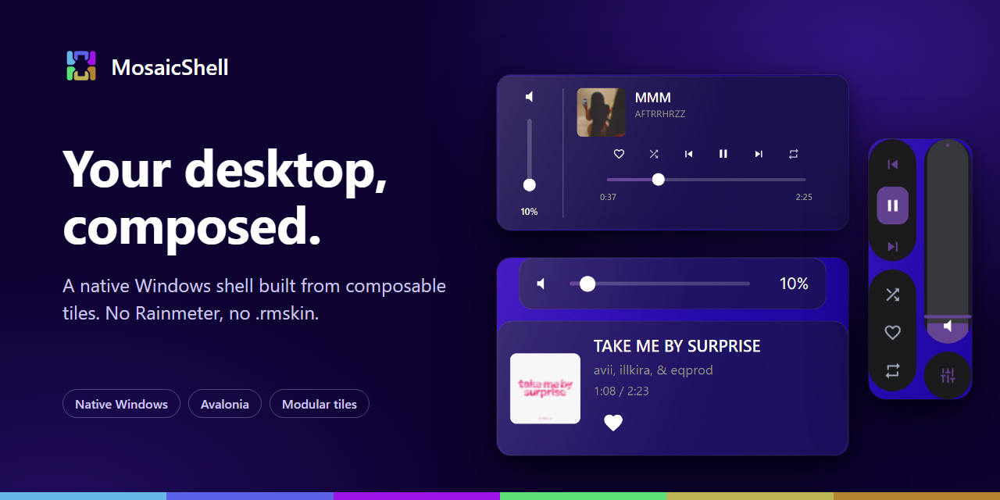
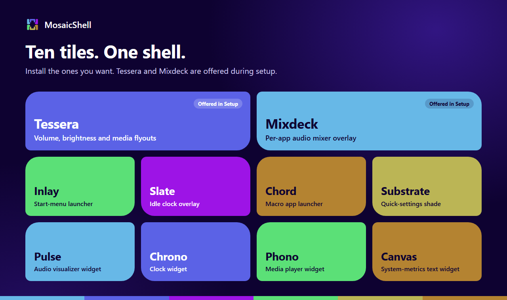
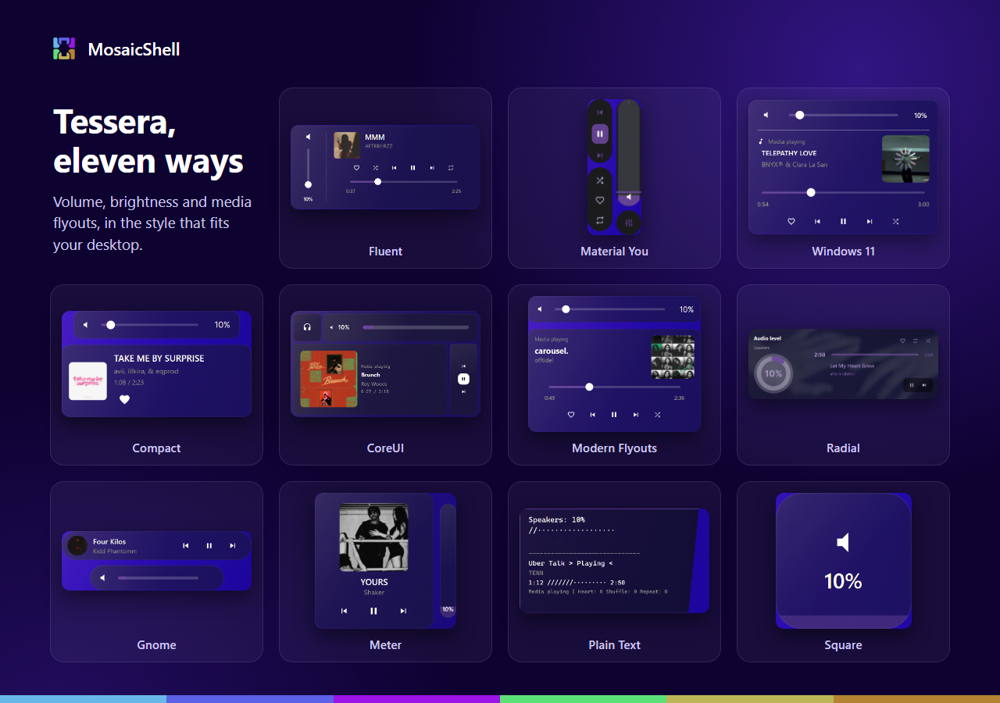

# MosaicShell

> _Your desktop, composed._




---

## About

MosaicShell is a desktop shell for Windows and Linux (KDE Plasma and GNOME) built from modules, with no Rainmeter and no `.rmskin`. Some modules work in the background, like Tessera's volume and media pop-ups or the Mixdeck mixer; widgets sit on the desktop. MosaicShell's window, the Hub, lists every module and widget, each with an on switch and a page of its own settings that apply as you change them.

It continues the JaxCore idea of a modular desktop (forked from [Jax-Core/JaxCore](https://github.com/Jax-Core/JaxCore), archived November 2024). Historical Rainmeter sources live in the [Jax-Core archives](https://github.com/Jax-Core).

---

## Prerequisites

| Requirement  | Minimum                                                                                                                                  |
| ------------ | ---------------------------------------------------------------------------------------------------------------------------------------- |
| OS           | Windows 10 version 2004 (build 19041) or later, x64; or Linux x86_64 with KDE Plasma 6 (checked on 6.6 and 6.8) or GNOME (checked on 51) |
| .NET Runtime | None: the Windows and Linux builds both ship their own                                                                                   |
| .NET SDK     | 11.0, only to build from source                                                                                                          |
| Browser      | Optional: Edge or Chrome 116 or later (on Linux also Chromium, Brave or Vivaldi), for the Grout extension                                |

## Install

### Setup.exe (recommended)

1. Download `MosaicShell-Setup-*.exe` from [Releases](https://github.com/uairhahs/MosaicShell/releases).
2. Run the installer (per-user under `%LocalAppData%\Programs\MosaicShell`).
3. Launch MosaicShell from the Start Menu. Default modules (Tessera, Mixdeck) are offered during setup.

**Check for updates** (Settings, Updates) downloads the latest Setup and runs a silent upgrade.

Release tags use date-build (`yyyy.M.d-bN`, e.g. `2026.8.23-b1`), not semver.

### Linux

```bash
curl -fsSL https://raw.githubusercontent.com/uairhahs/MosaicShell/main/packaging/linux/mosaicist.sh | bash
```

This installs MosaicShell for your account only, with no root: the app and its own .NET runtime go to
`~/.local/lib/mosaicshell`, with a menu entry and a `mosaicshell` command in `~/.local/bin`, and the default modules
(Tessera, Mixdeck). The download is checked against the release's `SHA256SUMS.txt`. Run the same command again to
update; a running MosaicShell restarts on the new version. To remove it, run the script with `--uninstall` (your
settings and modules are kept):

```bash
curl -fsSL https://raw.githubusercontent.com/uairhahs/MosaicShell/main/packaging/linux/mosaicist.sh | bash -s -- --uninstall
```

What to expect on Linux:

- **KDE Plasma 6 (Wayland):** checked live with Tessera's flyouts (volume, brightness, media, lock keys and
  airplane mode, from the keys), Mixdeck, the Pulse visualizer and the Grout browser bridge. Plasma's own volume
  and brightness pop-ups are hidden while Tessera is on.
- **GNOME (Wayland, checked on 51):** Tessera's volume, media, lock key and airplane mode flyouts, Slate's idle clock
  and the system accent colour work. MosaicShell installs a small GNOME Shell extension that hides GNOME's own
  volume and brightness pop-ups while Tessera is on, and shows MosaicShell's icon in the top bar while it runs, with
  Open MosaicShell and Quit MosaicShell. GNOME loads the extension after you log out and back in once; until then,
  open the Hub from the application menu, and a second launch brings the running MosaicShell forward. Not yet on
  GNOME: media keys and global shortcuts (including Mixdeck's Ctrl+Alt+X), the brightness flyout and Slate's
  fullscreen check.
- **Other modules and desktops:** the other modules, and desktops other than Plasma and GNOME, have not been checked
  on Linux yet.
- **Updates:** run the install command again. **Check for updates** in the Hub's Settings does not handle Linux yet.
- **Start at login:** **Start MosaicShell when I sign in** in the Hub's Settings writes an entry to
  `~/.config/autostart`, as it adds a Startup shortcut on Windows.

### Portable zip (advanced)

Download `MosaicShell-Portable-*.zip` (Windows), extract, and run `Host\MosaicShell.Host.exe`. Use `Mosaicist\` next to Host to install modules from the bundled `Tiles\` folder.

### From source (developers)

```powershell
cd host
dotnet test MosaicShell.Core.Tests
dotnet run --project Mosaicist -- install-module Tessera
dotnet run --project Mosaicist -- install-module Mixdeck
dotnet run --project MosaicShell.Host
```

The same commands work on Linux from a shell. Local Setup and Linux tarball builds: [packaging/README.md](packaging/README.md).

See [host/README.md](host/README.md) and [`.github/docs/parity.md`](.github/docs/parity.md).

**Honest MVP vs fidelity:** `tile_*_mvp` flags mean wiring, settings, and flagship behavior slices are in place, not full Jax-Core visual parity. Tessera layout is signed off (`tessera_layout_fidelity`; proofs in [`.github/res/Tessera/`](.github/res/Tessera/)). Other `*_layout_fidelity` flags stay false until in-repo screenshot proofs exist (see [`.github/docs/parity.md`](.github/docs/parity.md)). Install modules from the bundled `Tiles/{Id}/` stub via `Mosaicist install-module <id>` or the Setup post-install step.

---

## Known issues

### Browser media: Grout

If the media flyout shows a missing or wrong title, artist or cover for a browser tab or an installed web app (PWA),
install **Grout**, MosaicShell's own companion extension. Grout reads the title, artist and cover straight from the
player page, which is more reliable than what the browser reports to Windows (YouTube Music in particular often
reports a site-suffixed title or no artist). Get it from the link in the next section.

### YouTube Music: heart and thumbs-down

With the **Grout** browser extension installed, the heart and thumbs-down show and change the real state of the
track whatever the browser window is doing: covered by other windows, minimised, or in another tab. MosaicShell
registers Grout's connection for your account when it starts, so installing the extension is the only step, and it
needs no administrator rights. Get Grout from its
[Chrome Web Store listing](https://chromewebstore.google.com/detail/grout/pcjkacalabdgejinbmfdejicfhlonnpf); Edge
installs it from the same page once you allow extensions from other stores. Grout runs only on YouTube Music, YouTube, Spotify and SoundCloud, and talks only
to MosaicShell on your computer.

On Linux, MosaicShell registers Grout's connection for Edge, Chrome, Chromium, Brave and Vivaldi in the same way. On
Plasma it also publishes each Grout tab as a media player of its own, in place of the browser's, so Plasma's media
controls see the right title and the full-size cover. GNOME has no way to replace the browser's player, so there its
media controls keep the browser's own.

Without Grout on Windows, MosaicShell falls back to reading the player's buttons through Windows accessibility, which needs
nothing installed but sees only a window that is on screen. A browser stops updating the page of a window it
cannot see, so the buttons would show a state that may no longer be the page's; MosaicShell offers nothing rather
than a wrong state. The fallback does not work when:

- **The window is covered or minimised.** The buttons come back a few seconds after the window is visible again.
- **The player is in a background tab.** Only the tab being shown can be read.
- **The window is narrow.** YouTube Music takes the buttons out of its player bar in a narrow window.

---

## Troubleshooting and logs

MosaicShell writes diagnostic logs to `%LocalAppData%\MosaicShell\Cache\` on Windows and
`~/.local/share/MosaicShell/Cache/` on Linux (for example `flyout.log` for the Tessera flyouts). Logs stay on your computer; nothing is uploaded. Attach the relevant log when you open an issue.

- Every line carries the date, time, a per-run id and a level (`DEBUG`, `INFO`, `WARN`, `ERROR`), so runs can be
  told apart.
- Each log is capped at 4 MB plus one `.1.log` backup, so logs never grow without bound.
- Release builds record `INFO` and above. The detailed flyout trace is `DEBUG`, and it includes track titles and
  artists, so it is off unless you ask for it.

| Environment variable    | Effect                                                                                                                            |
| ----------------------- | --------------------------------------------------------------------------------------------------------------------------------- |
| `MOSAICSHELL_LOG_LEVEL` | `debug`, `info`, `warning` or `error`. Set `debug` to record the detailed flyout trace in a release build.                        |
| `MOSAICSHELL_HOME`      | Moves the whole data folder (settings, modules and logs) from `%LocalAppData%\MosaicShell` (Linux: `~/.local/share/MosaicShell`). |

To capture a detailed trace once, start the Host from PowerShell:

```powershell
$env:MOSAICSHELL_LOG_LEVEL = "debug"
& "$env:LocalAppData\Programs\MosaicShell\Host\MosaicShell.Host.exe"
```

On Linux, quit MosaicShell first from its icon (in the tray on Plasma, in the top bar on GNOME), then:

```bash
MOSAICSHELL_LOG_LEVEL=debug mosaicshell
```

---

## Modules

Every catalog module ships as a thin `Tiles/{Id}` install stub (`module.native.json` + README). Runtime code lives under `host/`.



| Module    | Description                                            | License |
| --------- | ------------------------------------------------------ | ------- |
| Tessera   | Volume / brightness / media flyouts                    | MPL-2.0 |
| Mixdeck   | Per-app audio mixer overlay                            | MPL-2.0 |
| Inlay     | Start-menu launcher (pins + search)                    | MPL-2.0 |
| Slate     | Idle clock overlay                                     | MPL-2.0 |
| Chord     | Macro app launcher                                     | MPL-2.0 |
| Substrate | Quick-settings shade                                   | MPL-2.0 |
| Pulse     | Audio visualizer widget                                | MIT     |
| Chrono    | Clock widget                                           | MIT     |
| Phono     | SMTC media widget                                      | MIT     |
| Canvas    | System-metrics text widget                             | MIT     |

### Tessera styles



---

## Credits

### Original project

MosaicShell is a fork of [JaxCore](https://github.com/Jax-Core/JaxCore) by [@EnhancedJax](https://github.com/EnhancedJax), archived November 2024. Historical Rainmeter plugin credits: [Jax-Core](https://github.com/Jax-Core).

---

## Contributing

Issues and pull requests are welcome. If you are building a module or widget compatible with MosaicShell, open an issue to discuss integration.

**Development:** [`.github/docs/`](.github/docs/) (testing, parity honesty, scaling), [`docs/architecture.md`](docs/architecture.md) (how the repo is put together), [`docs/parity/README.md`](docs/parity/README.md) (per-module MVP bars), [`docs/legacy/`](docs/legacy/) (what the Rainmeter-era modules promised).

---

## License

See [LICENSE](./LICENSE).
